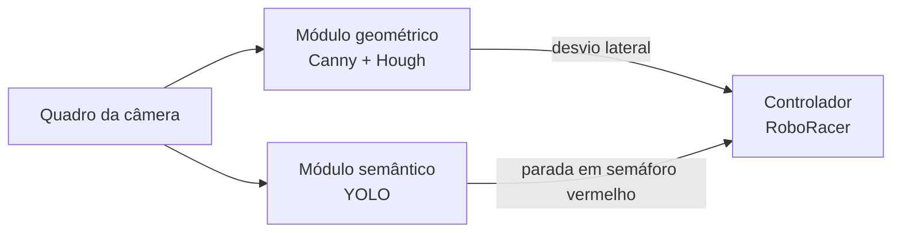

# Percepção visual para detecção de faixas, placas e semáforos em veículos autônomos

Projeto de Iniciação Científica do **Centro Universitário FEI** (Departamento de Ciência da Computação).

| | |
|---|---|
| **Aluna** | Isabella Vieira Silva Rosseto — `unifirosseto@fei.edu.br` |
| **Orientador** | Prof. Danilo Hernani Perico — `dperico@fei.edu.br` |
| **Bolsa** | PBIC [PBIC077/25], vigência 02/2026 a 12/2026 |
| **Plataforma alvo** | RoboRacer (veículo autônomo em escala reduzida) |
| **Dataset** | BDD100K completo (70.000 treino / 10.000 validação) |
| **Artigo** | SICFEI — [versão em Markdown](docs/08-artigo-sicfei.md) · [`.docx` original](docs/artigo/ArtigoSICFEI_Final.docx) |

O projeto investiga técnicas de visão computacional para a percepção de veículos autônomos em escala reduzida. O sistema tem dois módulos que processam o mesmo quadro da câmera em paralelo:

- **Módulo geométrico** (Canny + Transformada de Hough): estima o desvio lateral do veículo em relação ao centro da faixa e envia um sinal contínuo para a direção. *Implementado; avaliação e integração são a próxima etapa.*
- **Módulo semântico** (redes YOLO): detecta placas de trânsito e semáforos, separando o semáforo por cor (vermelho, amarelo, verde e apagado), e envia um comando de parada quando vê semáforo vermelho. *Avaliado no artigo.*



---

## Resultados principais

Quatro arquiteturas foram treinadas com o **mesmo protocolo** (100 épocas, batch 16, 640×640, SGD, pesos iniciais do COCO) no BDD100K completo, numa RTX 4060. Valores no conjunto de validação:

| Métrica | YOLOv8m | YOLOv10m | YOLOv11m | YOLO26 |
|---|---:|---:|---:|---:|
| mAP50 | 0,556 | 0,549 | **0,578** | 0,563 |
| mAP50-95 | 0,317 | 0,314 | **0,334** | 0,322 |
| Precision | 0,646 | **0,732** | 0,689 | 0,658 |
| Recall | 0,502 | 0,495 | **0,531** | 0,509 |
| AP50 semáforo vermelho | 0,568 | 0,561 | **0,592** | 0,575 |
| Tempo de treino | **20h34min** | 23h24min | 21h12min | 21h50min |


**Conclusões:**

- **YOLOv11m** teve o melhor equilíbrio geral: maior mAP50, mAP50-95, Recall e AP50 em todas as classes. É o mais indicado para a RoboRacer.
- **YOLOv10m** teve a maior Precision (0,732), o que significa menos paradas indevidas. É preferível quando evitar falsos positivos for a prioridade.
- **YOLO26** não superou o YOLOv11m em nenhuma métrica, apesar de ter mais parâmetros (~26,0M contra ~20,1M).
- **YOLOv8m** foi o mais rápido de treinar.
- Semáforo **amarelo** e **apagado** tiveram os piores resultados, por terem poucas amostras (~8 mil cada no treino, contra ~71 mil do vermelho e do verde).

Tabelas por classe (AP50, Precision e Recall), figuras e referências em [docs/08-artigo-sicfei.md](docs/08-artigo-sicfei.md).

---

## Situação do projeto

| Etapa | Situação |
|---|---|
| Fase preliminar: YOLOv8m vs YOLOv10m, classes simplificadas | ✅ Concluída — código em [`codigo/`](codigo/) |
| Classes em português, semáforo separado por cor (vermelho/amarelo/verde/apagado) | ✅ Concluída (código ainda não está no repositório) |
| Treino final de YOLOv8m, YOLOv10m, YOLOv11m e YOLO26 no BDD100K completo | ✅ Concluído (código e pesos ainda não estão no repositório) |
| Artigo SICFEI | ✅ [Concluído](docs/08-artigo-sicfei.md) |
| Módulo geométrico de faixa (Canny + Hough) | ⚠️ Implementado, falta avaliar (código ainda não está no repositório) |
| Integração dos dois módulos no controlador | ⏳ Próxima etapa |
| Repetição dos treinos com sementes diferentes e validação cruzada | ⏳ Próxima etapa |
| Testes estatísticos entre modelos (Friedman e Wilcoxon) | ⏳ Próxima etapa |
| Balanceamento de semáforo amarelo e apagado | ⏳ Próxima etapa |
| Testes na RoboRacer física | ⏳ Futuro |

**Limitações apontadas no artigo:** um único treino por arquitetura (diferenças pequenas de mAP50 podem estar dentro da variação normal entre execuções), avaliação só em software sobre o BDD100K e desbalanceamento das classes de semáforo amarelo e apagado.

---

## Navegação rápida

| Quero... | Vá para |
|---|---|
| Ler o artigo com os resultados finais | [docs/08-artigo-sicfei.md](docs/08-artigo-sicfei.md) |
| Entender o objetivo, o dataset e os modelos | [docs/01-visao-geral.md](docs/01-visao-geral.md) |
| Preparar o ambiente e baixar o dataset | [docs/02-instalacao.md](docs/02-instalacao.md) |
| Rodar o pipeline (comandos e todas as opções) | [docs/03-como-executar.md](docs/03-como-executar.md) |
| Entender como o código funciona por dentro | [docs/04-arquitetura-do-codigo.md](docs/04-arquitetura-do-codigo.md) |
| Ver a lista de bugs e limitações do código | [docs/05-problemas-conhecidos.md](docs/05-problemas-conhecidos.md) |
| Corrigir os bugs com ajuda de um assistente de IA | [docs/06-prompts-de-correcao.md](docs/06-prompts-de-correcao.md) |
| Entender termos como mAP, IoU, época, batch | [docs/07-glossario.md](docs/07-glossario.md) |
| Ver os registros das primeiras execuções | [resultados/README.md](resultados/README.md) |
| Ver os arquivos de código e o que cada um faz | [codigo/README.md](codigo/README.md) |

---

## Estrutura do repositório

```
IC_VeiculosAutonomos/
├── README.md                  ← você está aqui (resumo do projeto e índice)
├── .gitignore                 ← ignora dataset, pesos, runs e ambiente virtual
├── .vscode/                   ← configuração de debug/intérprete do VS Code
│
├── codigo/                    ← código da fase preliminar (YOLOv8m vs YOLOv10m)
│   ├── README.md              ← o que cada arquivo faz
│   ├── train.py               ← pipeline completo: GPU → conversão → treino v8 → treino v10 → comparação
│   ├── requirements.txt
│   └── scripts/               ← as mesmas etapas, separadas em scripts independentes
│
├── docs/                      ← documentação detalhada (leia em ordem numérica)
│   ├── 01-visao-geral.md
│   ├── 02-instalacao.md
│   ├── 03-como-executar.md
│   ├── 04-arquitetura-do-codigo.md
│   ├── 05-problemas-conhecidos.md
│   ├── 06-prompts-de-correcao.md
│   ├── 07-glossario.md
│   ├── 08-artigo-sicfei.md    ← artigo com os resultados finais
│   └── artigo/
│       ├── ArtigoSICFEI_Final.docx
│       └── figuras/           ← figuras do artigo
│
└── resultados/                ← registros das primeiras execuções (abril/2026, só referência)
    ├── README.md
    └── anteriores/
```

> [!NOTE]
> O código em [`codigo/`](codigo/) é o da **fase preliminar**: compara só YOLOv8m e YOLOv10m, com as 10 classes originais do BDD100K em inglês. O código dos treinos finais (4 arquiteturas, classes em português) e o do módulo de faixa ainda precisam ser adicionados ao repositório. Os registros em [`resultados/`](resultados/) são das primeiras execuções, com dataset incompleto, e **não** correspondem aos resultados do artigo.

---

## Início rápido (código da fase preliminar)

> Detalhes e solução de problemas em [docs/02-instalacao.md](docs/02-instalacao.md) e [docs/03-como-executar.md](docs/03-como-executar.md).

```bash
# 1. Clonar e criar o ambiente
git clone https://github.com/IsaRosseto/IC_VeiculosAutonomos.git
cd IC_VeiculosAutonomos
python -m venv .venv
source .venv/bin/activate              # Windows: .venv\Scripts\activate
pip install -r codigo/requirements.txt

# 2. Conferir se a GPU está visível para o PyTorch (precisa imprimir True)
python -c "import torch; print(torch.cuda.is_available())"

# 3. Baixar o BDD100K (Kaggle: solesensei/bdd100k) e extrair em codigo/bdd100k/

# 4. Rodar o pipeline completo
cd codigo
python train.py --source ./bdd100k --batch 8
```

Saídas principais:

- `codigo/runs/detect/<modelo>/weights/best.pt` — pesos treinados
- `codigo/results/comparison/<data_hora>/` — gráfico, CSVs e imagens lado a lado

**Hardware:** os treinos do artigo usaram GPU NVIDIA RTX 4060, Intel Core i7 de 13ª geração e 16 GB de RAM, com cerca de 20 a 23 horas por modelo. Em CPU o treino é inviável. Leia o [problema 5 (memória RAM)](docs/05-problemas-conhecidos.md#5-cache-em-ram) antes de treinar com o dataset completo.
