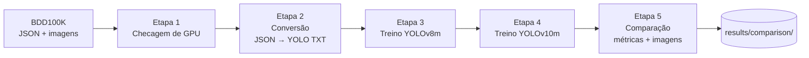

# IC Veículos Autônomos — YOLOv8m vs YOLOv10m no BDD100K

Projeto de Iniciação Científica que compara dois detectores de objetos, **YOLOv8m** e **YOLOv10m**, no dataset de direção autônoma **BDD100K** (Berkeley DeepDrive). O pipeline converte as anotações do dataset para o formato YOLO, treina os dois modelos nas mesmas condições e gera métricas (mAP50, mAP50-95, precisão, recall) e imagens comparativas lado a lado.

> [!WARNING]
> **Estado atual:** o código roda, mas tem [problemas conhecidos](docs/05-problemas-conhecidos.md). Os resultados guardados em [`resultados/`](resultados/) **não são confiáveis**: o treino usou só 1,6% das imagens, apenas 13 épocas do YOLOv8m foram concluídas e o YOLOv10m nunca foi treinado. Eles servem só como registro histórico.

---

## Navegação rápida

| Quero... | Vá para |
|---|---|
| Entender o objetivo, o dataset e os modelos | [docs/01-visao-geral.md](docs/01-visao-geral.md) |
| Preparar o ambiente e baixar o dataset | [docs/02-instalacao.md](docs/02-instalacao.md) |
| Rodar o pipeline (comandos e todas as opções) | [docs/03-como-executar.md](docs/03-como-executar.md) |
| Entender como o código funciona por dentro | [docs/04-arquitetura-do-codigo.md](docs/04-arquitetura-do-codigo.md) |
| Ver a lista de bugs e limitações | [docs/05-problemas-conhecidos.md](docs/05-problemas-conhecidos.md) |
| Corrigir os bugs com ajuda de um assistente de IA | [docs/06-prompts-de-correcao.md](docs/06-prompts-de-correcao.md) |
| Entender termos como mAP, IoU, época, batch | [docs/07-glossario.md](docs/07-glossario.md) |
| Ver os resultados das execuções anteriores | [resultados/README.md](resultados/README.md) |
| Ver os arquivos de código e o que cada um faz | [codigo/README.md](codigo/README.md) |

---

## Estrutura do repositório

```
IC_VeiculosAutonomos/
├── README.md                  ← você está aqui (índice geral)
├── .gitignore                 ← ignora dataset, pesos, runs e ambiente virtual
├── .vscode/                   ← configuração de debug/intérprete do VS Code
│   ├── launch.json
│   └── settings.json
│
├── codigo/                    ← código-fonte do pipeline (antiga pasta IA-teste-main/)
│   ├── README.md              ← o que cada arquivo faz
│   ├── train.py               ← pipeline completo: GPU → conversão → treino v8 → treino v10 → comparação
│   ├── requirements.txt       ← dependências Python
│   └── scripts/               ← as mesmas etapas, separadas em scripts independentes
│       ├── convert_bdd100k.py     ← só a conversão JSON → YOLO TXT
│       ├── train_yolo.py          ← só o treino (--version v8 | v10 | both)
│       ├── inference_compare.py   ← só a comparação (métricas + imagens)
│       └── test_convert_bbox.py   ← teste da fórmula de conversão de bounding box
│
├── docs/                      ← documentação detalhada (leia em ordem numérica)
│   ├── 01-visao-geral.md
│   ├── 02-instalacao.md
│   ├── 03-como-executar.md
│   ├── 04-arquitetura-do-codigo.md
│   ├── 05-problemas-conhecidos.md
│   ├── 06-prompts-de-correcao.md
│   └── 07-glossario.md
│
└── resultados/                ← registros das execuções anteriores (somente referência)
    ├── README.md              ← análise de cada execução
    └── anteriores/
        ├── treino_yolov8m/        ← args.yaml + results.csv do treino do YOLOv8m
        └── comparacoes/           ← CSVs e imagens lado a lado geradas pela etapa 5
```

Pastas **geradas** pelo pipeline ao rodar (não ficam no Git, veja o [`.gitignore`](.gitignore)):

```
codigo/
├── bdd100k/      ← dataset original extraído (você coloca aqui, ~10 GB)
├── data/bdd100k/ ← dataset convertido para YOLO (labels .txt + data.yaml + links das imagens)
├── runs/detect/  ← treinos do Ultralytics (pesos best.pt / last.pt, gráficos, results.csv)
├── results/      ← comparações (gráfico, CSV, imagens lado a lado)
└── wandb/        ← logs do Weights & Biases (se ativado)
```

---

## Início rápido

> Detalhes e solução de problemas em [docs/02-instalacao.md](docs/02-instalacao.md) e [docs/03-como-executar.md](docs/03-como-executar.md).

```bash
# 1. Clonar e criar o ambiente
git clone https://github.com/IsaRosseto/IC_VeiculosAutonomos.git
cd IC_VeiculosAutonomos
python -m venv .venv
source .venv/bin/activate              # Windows: .venv\Scripts\activate
pip install -r codigo/requirements.txt

# 2. Conferir se a GPU está visível para o PyTorch (precisa imprimir True)
python -c "import torch; print(torch.cuda.is_available())"

# 3. Baixar o BDD100K (Kaggle: solesensei/bdd100k) e extrair em codigo/bdd100k/

# 4. Rodar o pipeline completo
cd codigo
python train.py --source ./bdd100k --batch 8
```

Saídas principais:

- `codigo/runs/detect/<modelo>/weights/best.pt` — pesos treinados
- `codigo/results/comparison/<data_hora>/` — gráfico, CSVs e imagens lado a lado

**Hardware mínimo:** GPU NVIDIA com 6 GB de VRAM. Em CPU o treino é inviável. Leia o [problema 5 (memória RAM)](docs/05-problemas-conhecidos.md#5-cache-em-ram) **antes** de treinar com o dataset completo.

---

## Pipeline em uma figura



---

## Situação do projeto

| Item | Situação |
|---|---|
| Conversão BDD100K → YOLO | ✅ Funciona (com ressalvas: [problemas 6 e 13](docs/05-problemas-conhecidos.md)) |
| Treino YOLOv8m | ⚠️ Rodou 13 de 100 épocas com dataset incompleto |
| Treino YOLOv10m | ❌ Nunca executado |
| Comparação de resultados | ⚠️ Roda, mas só com o v8 e com métricas inválidas |
| Documentação | ✅ Este repositório |
| Próximo passo recomendado | Corrigir os problemas na [ordem sugerida](docs/06-prompts-de-correcao.md#ordem-recomendada), extrair o dataset completo e treinar de novo |
