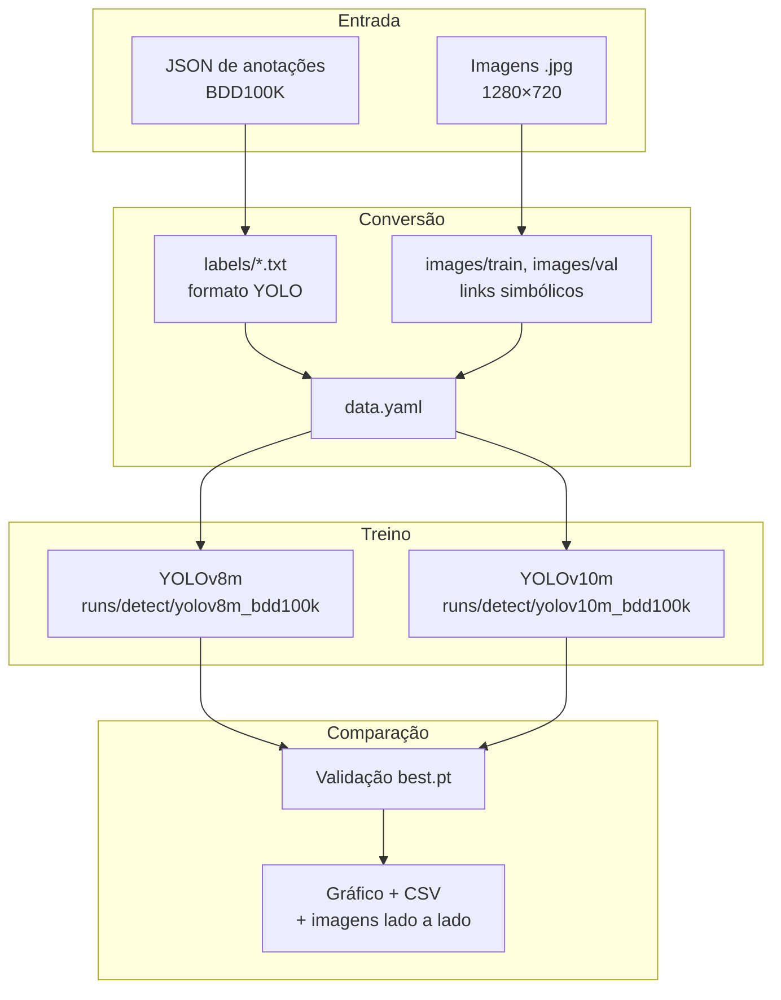

# 1. Visão geral

[← Índice](../README.md) · [Próximo: Instalação →](02-instalacao.md)

---

## Objetivo

Comparar, nas mesmas condições de treino, dois detectores de objetos da família YOLO aplicados a cenas de trânsito:

| Modelo | Ano | Diferença principal |
|---|---|---|
| **YOLOv8m** | 2023 (Ultralytics) | Detector *anchor-free* com pós-processamento por NMS (*Non-Maximum Suppression*) |
| **YOLOv10m** | 2024 (Tsinghua, integrado ao Ultralytics) | Treino com *dual assignments* que dispensa o NMS na inferência (detecção *end-to-end*), com foco em menor latência |

O sufixo **m** indica o tamanho *medium* das duas famílias, o que deixa a comparação justa em número de parâmetros.

A pergunta da pesquisa é: **no contexto de veículos autônomos, o YOLOv10m é melhor que o YOLOv8m em precisão e velocidade?**

## Métricas comparadas

| Métrica | O que mede |
|---|---|
| **mAP50** | Precisão média das 10 classes, considerando acerto quando a caixa prevista tem IoU ≥ 0,5 com a real |
| **mAP50-95** | Mesma ideia, mas com média de IoU de 0,50 a 0,95 (mais rigorosa) |
| **Precision** | Das caixas previstas, quantas estão corretas |
| **Recall** | Dos objetos reais, quantos foram encontrados |
| **Tempo de treino** | Duração total do treino de cada modelo |

Definições mais completas no [glossário](07-glossario.md).

## Dataset: BDD100K

O **BDD100K** (Berkeley DeepDrive) tem 100 mil vídeos de direção gravados nos EUA, em diferentes horários, climas e tipos de via. Para detecção de objetos usa-se um quadro por vídeo:

| Divisão | Imagens | Uso no projeto |
|---|---|---|
| `train` | 70.000 | Treino |
| `val` | 10.000 | Validação e métricas |
| `test` | 20.000 | Não usado (sem anotações públicas) |

- Resolução: **1280 × 720** pixels.
- Anotações originais: um JSON por divisão (`bdd100k_labels_images_train.json`, `..._val.json`), com uma lista de objetos por imagem e as caixas no formato `x1, y1, x2, y2` em pixels.
- Fonte usada: Kaggle, dataset [`solesensei/bdd100k`](https://www.kaggle.com/datasets/solesensei/bdd100k).

### As 10 classes de detecção

O ID é a posição na lista `BDD100K_CLASSES` do código, e é o número que aparece na primeira coluna de cada linha dos arquivos `.txt` do formato YOLO.

| ID | Classe | Descrição |
|---|---|---|
| 0 | `person` | Pedestre |
| 1 | `rider` | Pessoa sobre bicicleta ou moto |
| 2 | `car` | Carro |
| 3 | `bus` | Ônibus |
| 4 | `truck` | Caminhão |
| 5 | `bike` | Bicicleta |
| 6 | `motor` | Motocicleta |
| 7 | `traffic light` | Semáforo |
| 8 | `traffic sign` | Placa de trânsito |
| 9 | `train` | Trem |

Categorias que existem no JSON mas não estão nessa lista (por exemplo `drivable area` e `lane`, que não têm `box2d`) são descartadas na conversão.

## Configuração de treino usada no código

Os dois modelos são treinados com os mesmos hiperparâmetros (definidos em `train_single_model` no [`train.py`](../codigo/train.py)):

| Parâmetro | Valor | Observação |
|---|---|---|
| Épocas | 100 (`--epochs`) | Sem *early stopping* (`patience=0`) |
| Tamanho de imagem | 640 | Fixo no `train.py`; configurável no `train_yolo.py` |
| Batch | 8 (`--batch`) | Pensado para GPU de 6 GB (RTX 2060) |
| Pesos iniciais | `yolov8m.pt` / `yolov10m.pt` | Pré-treinados no COCO, baixados automaticamente |
| AMP | Ativado | Precisão mista (FP16) |
| Learning rate | Cosseno (`cos_lr=True`) | |
| Mosaic | Desligado nas 10 últimas épocas (`close_mosaic=10`) | |
| Checkpoint | A cada 5 épocas (`save_period=5`) | |
| Cache | `"ram"` | ⚠️ Veja o [problema 5](05-problemas-conhecidos.md#5-cache-em-ram) |
| Workers | 12 | Fixo no código |

## Visão do fluxo

---

[← Índice](../README.md) · [Próximo: Instalação →](02-instalacao.md)
