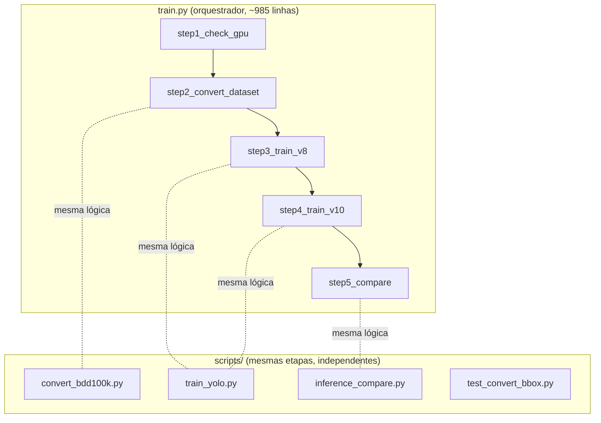

# 4. Arquitetura do código

[← Como executar](03-como-executar.md) · [Índice](../README.md) · [Próximo: Problemas conhecidos →](05-problemas-conhecidos.md)

---

Este documento explica como o código em [`codigo/`](../codigo/) está organizado, função por função. Os números de linha se referem à versão atual dos arquivos.

## Relação entre os arquivos



O `train.py` **não importa** os scripts: cada arquivo tem a sua própria cópia das funções. Por isso uma correção feita em um arquivo não chega aos outros ([problema 7](05-problemas-conhecidos.md#7-duplicação)).

Os quatro arquivos calculam a raiz do projeto a partir da própria localização (`Path(__file__).resolve()`), então **todos os caminhos de saída ficam dentro de `codigo/`**, não importa de onde o comando é executado.

| Constante | Valor |
|---|---|
| `PROJECT_ROOT` | `codigo/` |
| `DATA_DIR` | `codigo/data/bdd100k` |
| `DATA_YAML` | `codigo/data/bdd100k/data.yaml` |
| `RUNS_DIR` | `codigo/runs/detect` |
| `RESULTS_DIR` | `codigo/results/comparison` |

---

## `train.py` — mapa das funções

### Constantes (linhas 43–88)

| Nome | Conteúdo |
|---|---|
| `BDD100K_CLASSES` | Lista das 10 classes (a ordem define o ID) |
| `CLASS_TO_ID` | Dicionário `nome → id` |
| `IMG_WIDTH`, `IMG_HEIGHT` | 1280 × 720 (fixos) |
| `MODEL_CONFIGS` | Para `v8` e `v10`: arquivo de pesos, nome do run, nome de exibição e cor do gráfico |
| `CLASS_COLORS` | Cor BGR de cada classe nas imagens comparativas |

### Etapa 1 — ambiente

| Função | Linha | O que faz |
|---|---|---|
| `step1_check_gpu()` | 120 | Aplica o patch global do `torch.load` ([problema 10](05-problemas-conhecidos.md#10-torchload)), mostra versões e dados da GPU. Sem CUDA, roda `nvidia-smi` para diagnóstico e pergunta se deve continuar |

### Etapa 2 — conversão

| Função | Linha | O que faz |
|---|---|---|
| `convert_bbox_to_yolo(x1, y1, x2, y2)` | 197 | Converte a caixa em pixels para o formato YOLO normalizado. Retorna `None` se a caixa for inválida |
| `find_source_paths(source_dir)` | 219 | Percorre a pasta com `os.walk` procurando os JSONs (nome com `train`/`val` e `label`/`det`) e as pastas `train`/`val` com `.jpg` dentro de um caminho com `image` |
| `process_json_labels(json, labels_dir, split)` | 261 | Lê o JSON inteiro e grava um `.txt` por imagem. Também grava `.txt` vazio para imagens sem objetos. Devolve estatísticas por classe |
| `link_images(src, dst, split)` | 311 | Liga `data/bdd100k/images/<split>` à pasta original. Tenta *junction* do Windows → symlink → cópia |
| `create_data_yaml()` | 383 | Grava o `data.yaml` com `path` **absoluto** ([problema 1](05-problemas-conhecidos.md#1-caminhos-absolutos)) |
| `step2_convert_dataset(source_dir)` | 405 | Coordena a etapa. Se já houver mais de 1.000 labels de treino e 100 de validação, não converte de novo |

### Etapas 3 e 4 — treino

| Função | Linha | O que faz |
|---|---|---|
| `check_and_resume(run_name)` | 485 | Se o run existe, mostra o menu Resume / Overwrite / Cancelar com `input()` |
| `init_wandb_safe(model_name, args)` | 536 | `wandb.init` dentro de `try/except`; se falhar, o treino segue sem WandB |
| `finish_wandb_safe()` | 567 | Fecha o run do WandB sem lançar erro |
| `train_single_model(version, args)` | 577 | Carrega `last.pt` (resume) ou os pesos pré-treinados, chama `model.train(...)`, valida o `best.pt` no fim e devolve um dicionário com status e métricas |
| `step3_train_v8(args)` / `step4_train_v10(args)` | 697 / 703 | Apenas chamam `train_single_model` com `"v8"` / `"v10"` |

### Etapa 5 — comparação

| Função | Linha | O que faz |
|---|---|---|
| `find_best_weights(version)` | 712 | Procura `runs/detect/<run>/weights/best.pt` (ou qualquer `best.pt` dentro do run) |
| `draw_detections(image, results, model_name)` | 725 | Desenha as caixas, a classe, a confiança e o nome do modelo no canto |
| `step5_compare(args, train_results)` | 755 | Valida cada modelo, gera o gráfico (só com 2 modelos), os dois CSVs e as imagens lado a lado (sorteadas com `random.sample`) |

### `main()` (linha 910)

Lê os argumentos, chama as etapas em ordem e imprime o resumo final com o status de cada modelo.

---

## Formato YOLO e a conversão de caixas

O BDD100K descreve cada objeto pelos cantos em pixels; o YOLO usa centro e tamanho normalizados entre 0 e 1:

```
BDD100K (JSON)                        YOLO (.txt, uma linha por objeto)
{"category": "car",                   2 0.537332 0.551826 0.145586 0.134069
 "box2d": {"x1": 594.61, "y1": 349.05,  │    │        │        │        └ h  = (y2-y1)/720
           "x2": 780.96, "y2": 445.58}} │    │        │        └ w  = (x2-x1)/1280
                                        │    │        └ yc = (y1+y2)/(2·720)
                                        │    └ xc = (x1+x2)/(2·1280)
                                        └ id da classe (car = 2)
```

Depois do cálculo, cada um dos quatro valores é limitado separadamente ao intervalo [0, 1]. Isso desloca caixas que saem da imagem ([problema 13](05-problemas-conhecidos.md#13-bbox)).

O `data.yaml` gerado fica assim:

```yaml
path: /caminho/absoluto/para/codigo/data/bdd100k
train: images/train
val: images/val
nc: 10
names: [person, rider, car, bus, truck, bike, motor, traffic light, traffic sign, train]
```

O Ultralytics acha o label de cada imagem trocando `images/` por `labels/` no caminho e `.jpg` por `.txt`.

---

## Scripts em `scripts/`

### `convert_bdd100k.py`

| Função | Linha | Equivalente no `train.py` |
|---|---|---|
| `convert_bbox_to_yolo` | 56 | `convert_bbox_to_yolo` (idêntica) |
| `find_source_paths` | 89 | `find_source_paths` — mas aqui o JSON precisa ter `labels` no nome (no `train.py` basta `label` ou `det`) |
| `process_json` | 146 | `process_json_labels` (nomes das chaves de estatística diferentes) |
| `create_data_yaml(output_dir)` | 217 | `create_data_yaml()` — aqui aceita pasta de saída |
| `setup_directory_structure` | 239 | `link_images` — ordem de tentativa invertida: symlink → junction → cópia |
| `print_stats` | 303 | Estatísticas impressas dentro de `step2_convert_dataset` |

### `train_yolo.py`

| Função | Linha | Equivalente no `train.py` |
|---|---|---|
| `patch_torch_load` | 52 | Bloco de patch dentro de `step1_check_gpu` |
| `print_gpu_info` | 75 | `step1_check_gpu` — ⚠️ usa `total_mem` (não existe) ([problema 4](05-problemas-conhecidos.md#4-total_mem)) |
| `init_wandb` / `finish_wandb` | 101 / 134 | `init_wandb_safe` / `finish_wandb_safe` (aqui registra os valores reais de `workers` e `imgsz`) |
| `check_existing_run` + `get_resume_decision` | 147 / 176 | `check_and_resume` |
| `train_model` | 218 | `train_single_model` — aceita `--imgsz`, `--workers`, `--save-period`; mantém `cache="ram"` fixo |

### `inference_compare.py`

| Função | Linha | Equivalente no `train.py` |
|---|---|---|
| `find_best_weights` | 73 | idem |
| `load_models` | 88 | Início de `step5_compare` |
| `get_validation_images` | 110 | Sorteio de imagens em `step5_compare` (aqui aceita `.png`, `.bmp`, e pasta customizada) |
| `draw_detections` | 136 | idem |
| `create_side_by_side` | 174 | Laço visual de `step5_compare` (aqui também conta as detecções de cada modelo) |
| `run_validation_metrics` | 223 | Bloco "Validação formal" |
| `create_metrics_chart` | 257 | Bloco "Gráfico comparativo" |
| `create_metrics_table` | 297 | Bloco "CSV" (não gera `training_summary.csv`) |

### `test_convert_bbox.py`

Script simples (sem `pytest`) com 6 casos: caixa centralizada, canto superior esquerdo, imagem inteira, caixa inválida, canto inferior direito e um valor real de carro. A função testada é uma **cópia** colada no próprio arquivo.

---

## Dependências externas usadas

| Biblioteca | Onde | Para quê |
|---|---|---|
| `ultralytics.YOLO` | treino e comparação | `YOLO(pesos)`, `.train()`, `.val()`, `.predict()` |
| `torch` | etapa 1 e treino | Detecção de GPU, `device` |
| `wandb` | treino | Registro dos experimentos (opcional) |
| `cv2` (OpenCV) | comparação | Ler imagens, desenhar caixas, juntar lado a lado |
| `matplotlib` | comparação | Gráfico de barras das métricas |
| `yaml` (vem com o Ultralytics) | conversão | Gravar o `data.yaml` |
| `tqdm` | conversão | Barras de progresso |

---

[← Como executar](03-como-executar.md) · [Índice](../README.md) · [Próximo: Problemas conhecidos →](05-problemas-conhecidos.md)
