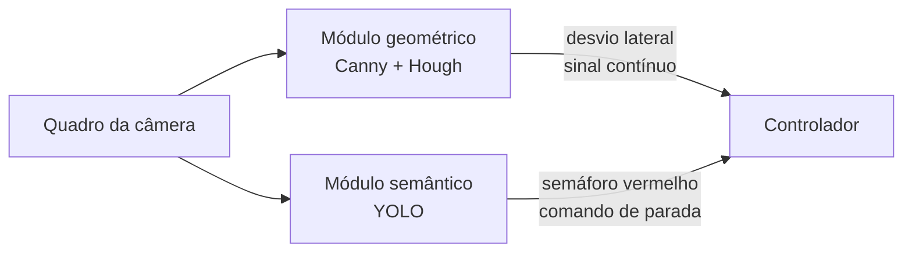
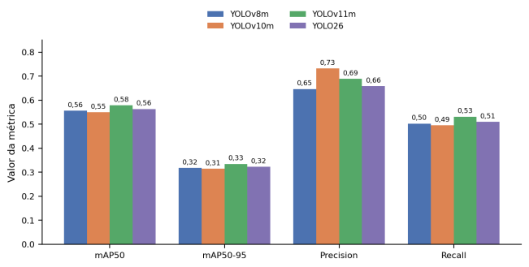
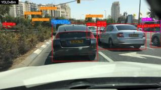
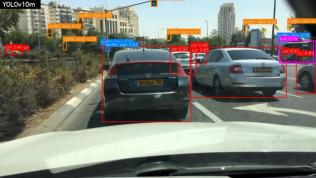
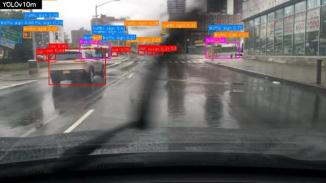

# 8. Artigo SICFEI — resultados finais

[← Glossário](07-glossario.md) · [Índice](../README.md)

---

Versão em Markdown do artigo submetido ao **SICFEI** (Simpósio de Iniciação Científica da FEI). O arquivo original está em [`artigo/ArtigoSICFEI_Final.docx`](artigo/ArtigoSICFEI_Final.docx).

> [!NOTE]
> Os resultados deste artigo vêm dos treinos finais (4 arquiteturas, BDD100K completo, classes em português). O código desses treinos e o do módulo de faixa **ainda não estão neste repositório**: o código em [`codigo/`](../codigo/) corresponde à fase preliminar (YOLOv8m vs YOLOv10m, 10 classes originais do BDD100K).

---

## Percepção visual para detecção de faixas, placas e semáforos em veículos autônomos

**Isabella Vieira Silva Rosseto¹, Danilo Hernani Perico¹**

¹ Departamento de Ciência da Computação, Centro Universitário FEI, São Bernardo do Campo, SP, Brasil
`unifirosseto@fei.edu.br`, `dperico@fei.edu.br`

Aluna de IC do Centro Universitário FEI, bolsa PBIC [PBIC077/25], vigência 02/2026 a 12/2026.

### Resumo

Este trabalho investiga técnicas de visão computacional para percepção de veículos autônomos em escala reduzida, com foco na plataforma RoboRacer. A abordagem combina um módulo geométrico clássico (Canny e Transformada de Hough) para segmentação de faixa com um módulo semântico baseado em redes neurais da família YOLO para detecção de placas de trânsito e semáforos, comparando as arquiteturas YOLOv8m, YOLOv10m, YOLOv11m e YOLO26 sobre o *dataset* completo BDD100K, com o esquema de classes expandido e traduzido para português (distinção de semáforo por cor). Os resultados finais indicam que o YOLOv11m obteve o melhor desempenho geral (mAP50 de 0,578 e mAP50-95 de 0,334), enquanto o YOLOv10m manteve a maior *Precision* (0,732), reduzindo falsos positivos relevantes para a segurança da navegação; o YOLO26 não superou o YOLOv11m em nenhuma métrica, apesar de mais parâmetros. Nesta fase, apenas o módulo semântico foi avaliado; a avaliação do módulo de faixa e sua integração ao semântico são a próxima etapa.

---

### 1. Introdução

Os acidentes de trânsito representam um problema crônico de saúde pública global: segundo a Organização Mundial da Saúde, cerca de 1,19 milhão de pessoas morrem anualmente em decorrência de acidentes rodoviários, sendo esta a principal causa de morte entre jovens de 5 a 29 anos [1]. No Brasil, dados do Instituto de Pesquisa Econômica Aplicada indicam mais de 30 mil mortes anuais em vias brasileiras, com custos socioeconômicos superiores a R$ 50 bilhões, e apontam que o erro humano responde por mais de 85% das causas primárias dos acidentes [2]. Esse cenário motiva o desenvolvimento de sistemas de percepção embarcados capazes de substituir ou suplementar a tomada de decisão humana.

Entre as modalidades sensoriais disponíveis, a visão computacional por câmeras ocupa papel central, por capturar textura, cor e estrutura semântica que sensores ativos como LiDAR e radar não reproduzem diretamente. Plataformas em escala reduzida, como a RoboRacer e a F1TENTH, oferecem ambiente controlado e de baixo custo para validar algoritmos de percepção antes da aplicação em escala real [3].

O objetivo deste trabalho é implementar, treinar e comparar sistematicamente arquiteturas da família YOLO para detecção de placas de trânsito e semáforos, complementadas por um módulo geométrico clássico de detecção de faixa.

### 2. Metodologia

O sistema de percepção é estruturado em dois módulos complementares, que processam o mesmo quadro em paralelo e enviam suas saídas ao mesmo controlador. O primeiro, geométrico, estima o desvio lateral do veículo em relação ao centro da faixa e fornece um sinal contínuo ao controlador do sistema de direção. Esse módulo está implementado, mas sua avaliação e integração são a próxima etapa, por isso não há resultados dele neste artigo.

O segundo módulo, semântico, realiza a detecção de placas de trânsito e semáforos por meio de redes da família YOLO e fornece ao controlador um comando discreto de parada ao detectar semáforo vermelho acima de um limiar de confiança. Nesta etapa, o esquema de classes foi expandido e traduzido para o português: a classe genérica de semáforo foi desmembrada em quatro estados (vermelho, amarelo, verde e apagado).

Não houve reanotação manual: os valores *red*, *yellow*, *green* e *none* (cor não identificável) do atributo nativo *trafficLightColor* do BDD100K [4] foram mapeados para vermelho, amarelo, verde e apagado. Os quatro estados foram incluídos no treinamento final, com o conjunto completo; na fase preliminar, o semáforo era uma classe única. A Tabela I traz as instâncias por classe.

**Tabela I — Instâncias por classe no BDD100K.**

| Conjunto | Placa | Vermelho | Verde | Amarelo | Apagado |
|---|---:|---:|---:|---:|---:|
| Treino | 175.724 | 71.482 | 71.631 | 7.844 | 8.043 |
| Validação | 34.908 | 12.123 | 11.987 | 1.351 | 1.424 |

Foram selecionadas quatro arquiteturas para comparação: YOLOv8m [6] (linha de base), YOLOv10m [5] (atribuição um-para-um, sem supressão não máxima), YOLOv11m [7] (atenção espacial C2PSA) e YOLO26 [8], o mais recente da Ultralytics, com inferência nativa ponta a ponta e otimizado para dispositivos de borda. Todos os modelos são inicializados com pesos pré-treinados no COCO e ajustados por *transfer learning* sobre o *dataset* BDD100K [4], que reúne imagens de condução real com ampla variabilidade de iluminação e condições climáticas. Utilizou-se a divisão oficial (70.000 imagens de treinamento, 10.000 de validação e 20.000 de teste); como os rótulos de teste não são públicos, os resultados referem-se à validação.

Para garantir que eventuais diferenças de desempenho sejam atribuídas à arquitetura, e não à configuração, todos os modelos são treinados sob o mesmo protocolo:

| Parâmetro | Valor |
|---|---|
| Épocas | 100 |
| Lote (*batch*) | 16 |
| Resolução de entrada | 640 × 640 |
| Otimizador | SGD (momento 0,937, taxa de aprendizado inicial 0,01) |
| Aumento de dados | Mosaico, espelhamento horizontal e perturbação HSV |
| Métricas | mAP50, mAP50-95, *Precision* e *Recall* (validação) |
| Hardware | GPU NVIDIA RTX 4060, Intel Core i7 13ª geração (série U), 16 GB de RAM |

### 3. Resultados

Em fase anterior, YOLOv8m e YOLOv10m foram treinados com classes simplificadas e 50% do BDD100K (mAP50 de 0,556 e 0,549). A seguir, os resultados finais (protocolo da Seção 2); todas as tabelas e figuras referem-se ao conjunto de validação.

**Tabela II — Comparação final entre as arquiteturas.**

| Métrica | YOLOv8m | YOLOv10m | YOLOv11m | YOLO26 |
|---|---:|---:|---:|---:|
| mAP50 | 0,556 | 0,549 | **0,578** | 0,563 |
| mAP50-95 | 0,317 | 0,314 | **0,334** | 0,322 |
| *Precision* | 0,646 | **0,732** | 0,689 | 0,658 |
| *Recall* | 0,502 | 0,495 | **0,531** | 0,509 |
| Tempo de treino | **20h34min** | 23h24min | 21h12min | 21h50min |

Conforme a Tabela II e a Figura 1, o YOLOv11m obteve o melhor desempenho geral, liderando mAP50, mAP50-95 e *Recall*. O YOLOv10m manteve a maior *Precision* (0,732), reduzindo comandos de parada indevidos. O YOLO26 tem mais parâmetros (~26,0M contra ~20,1M do YOLOv11m), mas não superou o YOLOv11m, e o YOLOv8m permanece o mais rápido para treinar.

**Figura 1 — Métricas globais das quatro arquiteturas.**

A Tabela III detalha o AP50 por classe. O YOLOv11m obteve o melhor resultado em todas as classes, com destaque para a placa de trânsito (0,634) e o semáforo vermelho (0,592), a classe mais crítica para o comando de parada. Semáforo amarelo e apagado tiveram os menores valores de AP50, devido ao menor número de amostras (Tabela I) e, no caso do apagado, à maior ambiguidade visual.

**Tabela III — AP50 por classe.**

| Classe | YOLOv8m | YOLOv10m | YOLOv11m | YOLO26 |
|---|---:|---:|---:|---:|
| Placa de trânsito | 0,612 | 0,605 | **0,634** | 0,619 |
| Semáforo vermelho | 0,568 | 0,561 | **0,592** | 0,575 |
| Semáforo verde | 0,542 | 0,535 | **0,566** | 0,548 |
| Semáforo amarelo † | 0,421 | 0,410 | **0,448** | 0,429 |
| Semáforo apagado ‡ | 0,385 | 0,378 | **0,415** | 0,392 |
| **Média AP50 (5 classes)** | 0,506 | 0,498 | **0,531** | 0,513 |

† Menor número de amostras. ‡ Maior ambiguidade visual.

As Tabelas IV e V mostram que o YOLOv10m manteve a maior *Precision* e o YOLOv11m o maior *Recall* em todas as classes, confirmando a Tabela II.

O AP50 médio das 5 classes (Tabela III) é inferior ao mAP50 da Tabela II porque este último é calculado sobre todas as classes do treino. Já a *Precision* e o *Recall* macro (Tabelas IV e V) ficam abaixo dos valores globais porque a métrica global é ponderada pelo volume de anotações (*micro-average*), enquanto a média macro pondera todas as classes igualmente, o que dá mais peso a semáforo amarelo e apagado.

**Tabela IV — *Precision* por classe.**

| Classe | YOLOv8m | YOLOv10m | YOLOv11m | YOLO26 |
|---|---:|---:|---:|---:|
| Placa de trânsito | 0,674 | **0,737** | 0,693 | 0,669 |
| Semáforo vermelho | 0,644 | **0,704** | 0,665 | 0,640 |
| Semáforo verde | 0,626 | **0,684** | 0,647 | 0,622 |
| Semáforo amarelo | 0,538 | **0,583** | 0,562 | 0,537 |
| Semáforo apagado | 0,510 | **0,556** | 0,537 | 0,509 |
| **Média simples (macro)** | 0,598 | **0,653** | 0,621 | 0,595 |
| **Média global (*Precision*)** | 0,646 | **0,732** | 0,689 | 0,658 |

**Tabela V — *Recall* por classe.**

| Classe | YOLOv8m | YOLOv10m | YOLOv11m | YOLO26 |
|---|---:|---:|---:|---:|
| Placa de trânsito | 0,536 | 0,528 | **0,552** | 0,537 |
| Semáforo vermelho | 0,505 | 0,497 | **0,523** | 0,506 |
| Semáforo verde | 0,487 | 0,479 | **0,504** | 0,487 |
| Semáforo amarelo | 0,397 | 0,387 | **0,418** | 0,401 |
| Semáforo apagado | 0,370 | 0,363 | **0,393** | 0,373 |
| **Média simples (macro)** | 0,459 | 0,451 | **0,478** | 0,461 |
| **Média global (*Recall*)** | 0,502 | 0,495 | **0,531** | 0,509 |

A Figura 2 compara YOLOv8m e YOLOv10m no mesmo quadro.

| YOLOv8m | YOLOv10m |
|---|---|
|  |  |

**Figura 2 — Exemplo de detecção: YOLOv8m (esquerda) vs. YOLOv10m (direita) no mesmo quadro.**

A Figura 3 repete a comparação em cena com chuva.

| YOLOv8m | YOLOv10m |
|---|---|
|  |  |

**Figura 3 — Segundo exemplo de detecção, em cena com chuva: YOLOv8m (esquerda) vs. YOLOv10m (direita).**

### 4. Conclusões

Nenhuma arquitetura dominou todas as métricas. O YOLOv11m apresentou o melhor equilíbrio geral (maior mAP50, mAP50-95, *Recall* e AP50 por classe, incluindo o semáforo vermelho) e seria o mais indicado para a RoboRacer; o YOLOv10m manteve a maior *Precision*, sendo preferível quando falsos positivos forem prioritários; o YOLO26 não superou o YOLOv11m apesar de mais parâmetros; e o YOLOv8m foi o mais rápido de treinar.

Como limitações: treino único por arquitetura (sem repetição de sementes), de modo que diferenças pequenas de mAP50 podem estar parcialmente dentro da variância normal entre execuções; avaliação restrita a *software* sobre o BDD100K, sem implementação física; e desbalanceamento das classes semáforo amarelo e apagado.

Próximas etapas: (i) avaliação do módulo de faixa e sua integração ao módulo semântico; (ii) validação cruzada (*cross-validation*) e repetição dos treinos com sementes distintas; (iii) testes de significância estatística entre os modelos (Friedman e Wilcoxon *signed-rank* [9]); e (iv) balanceamento de dados para semáforo amarelo e apagado.

### 5. Referências

1. Organização Mundial da Saúde, *Global Status Report on Road Safety 2023*, Geneva, 2023.
2. Instituto de Pesquisa Econômica Aplicada, *Acidentes de Trânsito nas Rodovias Federais Brasileiras*, Brasília, 2021.
3. O'Kelly, M. et al., *F1TENTH: An Open-Source Evaluation Platform for Autonomous Driving*, IEEE International Conference on Robotics and Automation (ICRA), 2017.
4. Yu, F., Chen, H., Wang, X. et al., *BDD100K: A Diverse Driving Dataset for Heterogeneous Multitask Learning*, Proceedings of CVPR, (2020) 2636-2645.
5. Wang, A. et al., *YOLOv10: Real-Time End-to-End Object Detection*, arXiv preprint arXiv:2405.14458, 2024.
6. Jocher, G., Chaurasia, A., Qiu, J., *Ultralytics YOLOv8* (Versão 8.0.0) [*software*], 2023. Disponível em: https://github.com/ultralytics/ultralytics.
7. Khanam, R., Hussain, M., *YOLOv11: An Overview of the Key Architectural Enhancements*, arXiv preprint arXiv:2410.17725, 2024.
8. Ultralytics, *Ultralytics YOLO26*, 2026. Disponível em: https://docs.ultralytics.com/models/yolo26/.
9. Demšar, J., *Statistical Comparisons of Classifiers over Multiple Data Sets*, Journal of Machine Learning Research 7 (2006) 1-30.

### Agradecimentos

À FEI, pela infraestrutura e recursos computacionais.

---

[← Glossário](07-glossario.md) · [Índice](../README.md)
