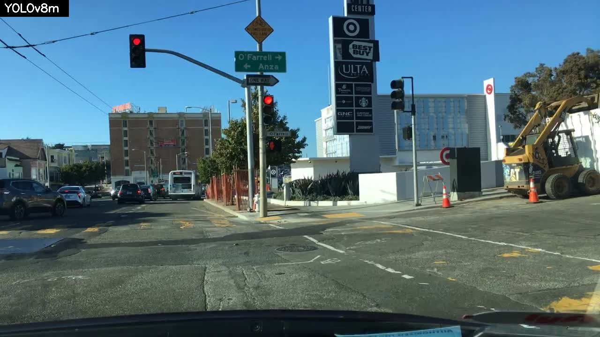

# `resultados/` — registros das execuções

[← Índice do repositório](../README.md)

> [!IMPORTANT]
> **Os resultados finais do projeto estão no [artigo SICFEI](../docs/08-artigo-sicfei.md)** (4 arquiteturas, BDD100K completo; melhor mAP50: YOLOv11m com 0,578). Esta pasta guarda só as primeiras execuções, de abril de 2026.

> [!WARNING]
> **Nenhum resultado desta pasta é válido para a pesquisa.** O treino usou só 1,6% das imagens de treino, parou na época 13 de 100 e o YOLOv10m nunca foi treinado. Estes arquivos são mantidos como registro histórico e para diagnóstico. Detalhes nos [problemas 2 e 3](../docs/05-problemas-conhecidos.md#2-dataset-incompleto).

## Conteúdo

```
resultados/
└── anteriores/                            Execuções de abril de 2026 (máquina original, Linux)
    ├── treino_yolov8m/
    │   ├── args.yaml                      Parâmetros do treino do YOLOv8m (gerado pelo Ultralytics)
    │   └── results.csv                    Métricas por época (13 épocas)
    └── comparacoes/
        ├── 20260408_121528/               Única comparação com métricas
        │   ├── metrics_comparison.csv
        │   ├── training_summary.csv
        │   └── visual/                    20 imagens com as detecções do YOLOv8m
        └── 20260408_124810/               Comparação sem modelos (os dois "skipped")
            ├── metrics_comparison.csv
            └── training_summary.csv
```

As execuções `20260407_152601`, `20260407_184755` e `20260408_124932` criaram pastas vazias (a comparação não encontrou modelos) e por isso não aparecem no Git.

## Linha do tempo

| Execução | Data/hora | YOLOv8m | YOLOv10m | Observação |
|---|---|---|---|---|
| `20260407_152601` | 07/04 15:26 | — | — | Pasta vazia |
| `20260407_184755` | 07/04 18:47 | — | — | Pasta vazia |
| `20260408_121528` | 08/04 12:15 | `interrupted` | `skipped` | Treino interrompido com Ctrl+C; comparação feita com o `best.pt` disponível |
| `20260408_124810` | 08/04 12:48 | `skipped` | `skipped` | Os dois treinos foram cancelados no menu; nenhuma métrica |
| `20260408_124932` | 08/04 12:49 | — | — | Pasta vazia |

---

## Treino do YOLOv8m — [`results.csv`](anteriores/treino_yolov8m/results.csv)

| Época | Tempo acumulado* | box_loss (treino) | Precision | Recall | mAP50 | mAP50-95 |
|---|---|---|---|---|---|---|
| 1 | 0,97 h | 0,309 | 0,000 | 0,000 | 0,000 | 0,000 |
| 2 | 0,89 h | 0,399 | 0,000 | 0,000 | 0,000 | 0,000 |
| 3 | 1,84 h | 0,447 | 0,000 | 0,000 | 0,000 | 0,000 |
| 4 | 2,83 h | 0,444 | 0,000 | 0,000 | 0,000 | 0,000 |
| 5 | 3,85 h | 0,399 | 0,100 | 0,000 | 0,050 | 0,030 |
| 6 | 4,84 h | 0,394 | 0,095 | 0,001 | 0,048 | 0,033 |
| 7 | 5,77 h | 0,364 | 0,195 | 0,002 | 0,098 | 0,055 |
| 8 | 6,65 h | 0,353 | 0,252 | 0,003 | 0,128 | 0,075 |
| **9** | 7,52 h | 0,348 | **0,341** | 0,003 | **0,172** | **0,113** |
| 10 | 8,40 h | 0,340 | 0,323 | 0,003 | 0,163 | 0,109 |
| 11 | 9,26 h | 0,333 | 0,315 | 0,004 | 0,160 | 0,103 |
| 12 | 10,14 h | 0,336 | 0,318 | 0,004 | 0,162 | 0,103 |
| 13 | 11,09 h | 0,334 | 0,318 | 0,005 | 0,161 | 0,103 |

\* A coluna `time` do Ultralytics é cumulativa. A queda entre as épocas 1 e 2 indica que o treino foi **retomado** (resume) e o contador recomeçou. Média: **~55 min por época** (39.936 s nas épocas 2–13).

### Parâmetros registrados — [`args.yaml`](anteriores/treino_yolov8m/args.yaml)

| Parâmetro | Valor no `args.yaml` | Valor no código atual (`train.py`) |
|---|---|---|
| `epochs` | 100 | 100 |
| `batch` | 4 | 8 (padrão de `--batch`) |
| `imgsz` | 640 | 640 |
| `workers` | 8 | 12 |
| `cache` | `false` | `"ram"` |
| `cos_lr` | `false` | `true` |
| `patience` | 0 | 0 |
| `resume` | `.../weights/last.pt` | — |
| `data` | `/home/gugzica3/Documents/IC_isabella/IA-teste-main/data/bdd100k/data.yaml` | gerado em `codigo/data/bdd100k/` |

As diferenças mostram que o treino foi feito com uma **versão anterior** do código, e o caminho absoluto em `data` ilustra o [problema 1](../docs/05-problemas-conhecidos.md#1-caminhos-absolutos).

---

## Comparação `20260408_121528`

[`metrics_comparison.csv`](anteriores/comparacoes/20260408_121528/metrics_comparison.csv):

| Modelo | mAP50 | mAP50-95 | Precision | Recall |
|---|---|---|---|---|
| YOLOv8m | 0,1715 | 0,1123 | 0,3396 | 0,0029 |

Os valores batem com a **época 9** do `results.csv`, a de melhor *fitness*, então a comparação usou o `best.pt` dessa época.

As 20 imagens em [`visual/`](anteriores/comparacoes/20260408_121528/visual/) mostram só o YOLOv8m (o v10 não existia). Nas imagens inspecionadas **nenhuma caixa foi desenhada**: com recall de 0,3%, praticamente nenhuma detecção passa do limiar de confiança 0,25.

Exemplo — [`compare_011_bf054de4-025bb1c3.jpg`](anteriores/comparacoes/20260408_121528/visual/compare_011_bf054de4-025bb1c3.jpg) (carros, ônibus e semáforos visíveis, nenhum detectado):



---

## Diagnóstico

| Sintoma | Causa mais provável |
|---|---|
| Recall ≈ 0,003 com precision ≈ 0,32 | O modelo quase nunca detecta. Treino com 1.160 imagens (1,6%) e poucas épocas |
| Métricas zeradas até a época 4 | Fase de *warmup* (3 épocas) somada ao dataset pequeno |
| `cls_loss` de validação ≈ 5,3 contra ≈ 0,73 no treino | Grande diferença entre treino e validação: *overfitting* nas poucas imagens de treino |
| YOLOv10m sempre `skipped` | Treinos cancelados no menu ou pelo `input()` sem terminal ([problema 8](../docs/05-problemas-conhecidos.md#8-input-interativo)) |

### O que esperar de um treino saudável

Nos treinos finais do [artigo](../docs/08-artigo-sicfei.md), com o BDD100K completo e 100 épocas, o YOLOv8m chegou a **mAP50 0,556 e recall 0,502**, contra 0,17 e 0,003 aqui. Como regra prática: recall abaixo de 0,1 depois de várias épocas indica erro de dados ou de configuração, não falta de treino. Por isso o [prompt 3](../docs/06-prompts-de-correcao.md#prompt-3--resultados-inválidos-re-treino-controlado-e-sanity-check) propõe um modo `--sanity` que verifica isso em poucas épocas.

---

## Como registrar um novo resultado

1. Crie uma pasta com data e descrição, por exemplo `resultados/2026-11_treino_completo/`.
2. Copie de `codigo/runs/detect/<run>/` os arquivos `args.yaml`, `results.csv` e os gráficos `.png` relevantes (não copie os `.pt`, são grandes).
3. Copie a pasta de `codigo/results/comparison/<data_hora>/`.
4. Adicione uma linha na [linha do tempo](#linha-do-tempo) e uma seção curta com a análise.
